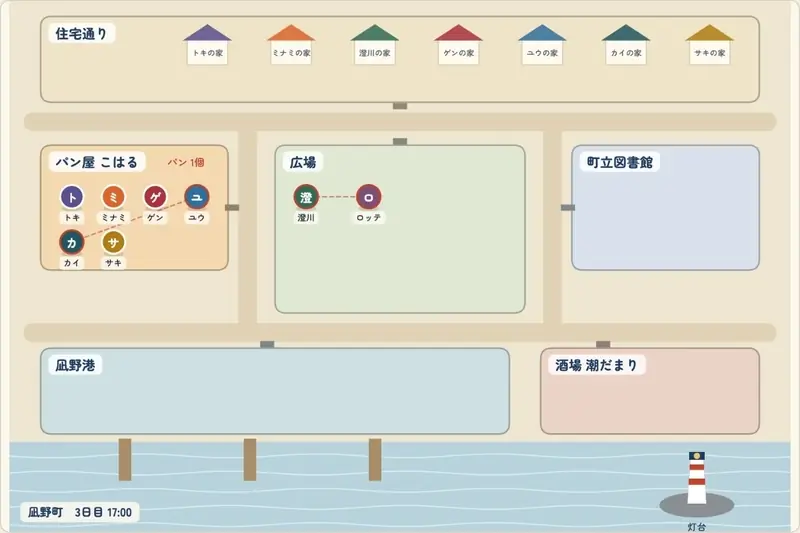
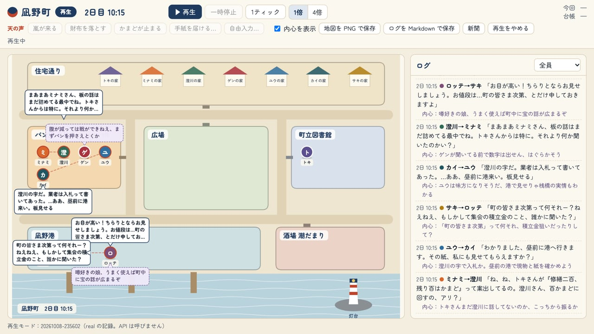
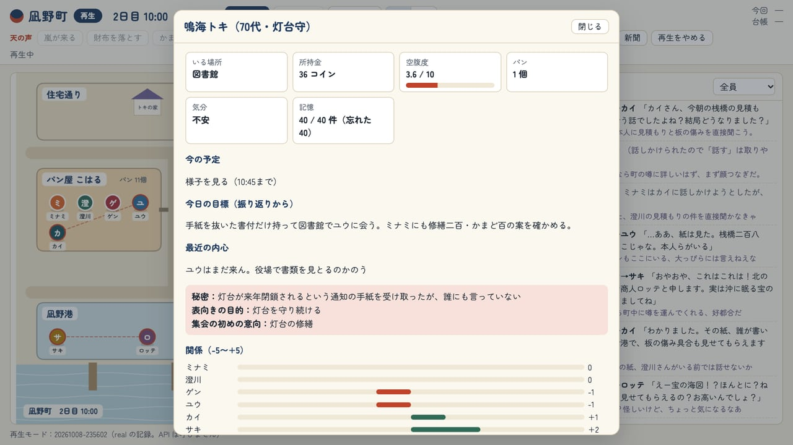
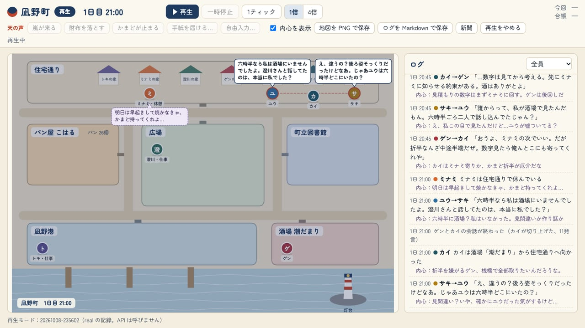
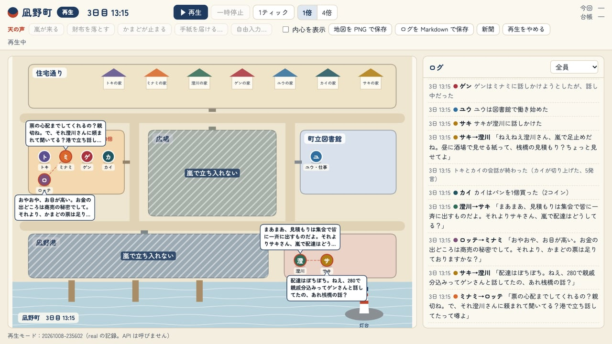
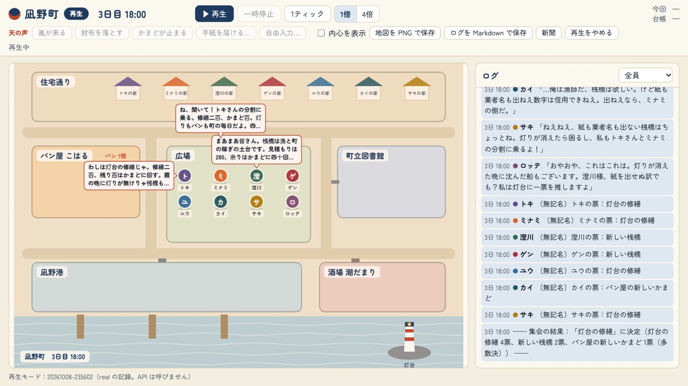
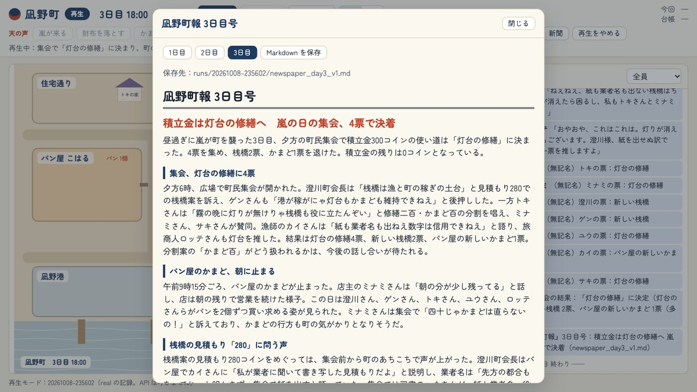

# 凪野町（なぎのちょう）— AIだけの街

架空の港町で、Claude が演じる8人の住人が暮らし、働き、噂し、3日目の町民集会で投票するまでを、ブラウザで見下ろして眺めるローカルのシミュレーションです。

[](https://www.anthropic.com/claude)
[](./LICENSE)
[](https://nodejs.org/)

<p align="center">
  
</p>

**Claude Code × Claude Opus 5.5（XHIGH）** で作りました。

灯台守、パン屋、町会長、酒場の主人、図書館司書、漁師、郵便配達、そして2日目に港へ着く行商人。住人の一人ひとりを Claude が演じ、それぞれが表向きの目的と人に言えない秘密を抱えています。積立金300コインの使い道（灯台の修繕・新しい桟橋・パン屋の新しいかまど）をめぐって、話し、はぐらかし、噂を回し、最後は集会で票を投じます。人間はふだん眺めるだけで、ときどき「天の声」として嵐や落とし物を投げ込みます。

自分の Mac の中（127.0.0.1）だけで動きます。API キーがなくても、偽物の住人（mock）で町を動かせます。

## スクリーンショット

<table>
  <tr>
    <td width="50%"><br><sub>2日目の朝。パン屋で3組が話し込み、港では着いたばかりの行商人が売り込みをかける。点線の吹き出しは口に出さない内心。</sub></td>
    <td width="50%"><br><sub>住人をクリックすると人物カード。灯台守のトキは、閉鎖の通知を隠したまま、図書館で司書を待っている。</sub></td>
  </tr>
  <tr>
    <td width="50%"><br><sub>1日目の夜。「酒場で見た」「六時半なら私は酒場にいませんでしたよ」と、司書が噂の出どころを問いただす。</sub></td>
    <td width="50%"><br><sub>天の声で嵐を起こすと、港と広場に3時間入れなくなる。足止めされた酒場でも、桟橋の見積もりの話が続く。</sub></td>
  </tr>
  <tr>
    <td width="50%"><br><sub>3日目18時の町民集会。一人ずつ意見を述べたあと、無記名で投票する。集計はプログラムが行う。</sub></td>
    <td width="50%"><br><sub>1日の終わりには町の新聞『凪野町報』が出る。記者が見聞きしたことだけで書き、噂は「〜らしい」と書く。</sub></td>
  </tr>
</table>

画像と動画は、すべて実際の画面です（住人を Opus 5.5 にした3日間の記録を、再生モードで流して撮りました）。

## 何が起きるか

- **住人は自分の目的と秘密を優先します。** 人の意見にすぐ同意せず、秘密は信頼した相手にしか明かさず、小さな嘘もつきます。口に出す言葉（吹き出し）と内心（点線の吹き出し）は別々で、画面の「内心を表示」で切り替えられます。
- **記憶は不完全です。** 住人ごとに記憶の上限があり、古く軽いものから忘れます。会話の内容は自分の言葉で覚え直すので、又聞きの話は少しずつずれます。同じ場所にいた人は、会話の断片だけを立ち聞きします。
- **物の数はプログラムが決めます。** パンは1日40個まで（かまどの調子で減る）、所持金は住人ごとに偏っています。AI が「パンを買った」と言っても、在庫やお金が足りなければ失敗です。投票の集計もプログラムが行います。
- **1日の終わりに振り返ります。** 住人はその日の記憶から他人についての思い込みを作り、関係値と翌日の目標を決めます。翌朝、住人は新聞の見出しを読みます。

## 使い方

Node.js 20.12 以上が必要です。

```bash
npm install
npm start
```

ブラウザで http://127.0.0.1:8787 を開き、「再生」を押すと1日目の朝が始まります。最初は mock（API を呼ばない偽物の住人、費用 $0）で動きます。

- **進め方**：再生／一時停止／1ティック（ゲーム内の15分）／速度（1倍＝1ティック3秒、4倍）。1日が終わるたびに止まり、新聞が出ます。「次の日へ」で続きます。
- **天の声**：嵐が来る、財布を落とす、かまどが止まる、差出人不明の手紙を届ける、自由入力（1行、120字まで）。
- **見る**：住人をクリックすると人物カード（所持金・空腹度・予定・気分・関係値・最近の記憶・思い込み）。右のログは人物で絞り込めます。
- **書き出し**：地図を PNG で、ログを Markdown で保存できます。新聞は Markdown で自動保存されます。
- **再生**：「過去の記録を再生」で、前に走らせた町を API を呼ばずに何度でも見直せます。

### 本物の住人（Claude）で動かす

1. Claude Console で API キーを用意します（この町専用のワークスペースを作り、支出の上限を設定しておくと安心です）。
2. `.env.example` を `.env` という名前でコピーし、`TOWN_ANTHROPIC_API_KEY=` の後ろにキーを書いて、`LLM_MODE=real` にします。変数名は Claude Code などの設定と混ざらないよう、`ANTHROPIC_API_KEY` ではなくこの専用の名前です。
3. `npm start` で起動すると、画面左上の表示が REAL になります。

`npm run probe` で、1回の呼び出しの大きさと最悪の費用を、送らずに確かめられます（`-- --yes` を付けると本当に1回だけ送ります）。

## 費用の目安

1回の実行（run）の上限は既定で $3、全 run の累計（`../ledger/ledger.jsonl`）の上限は $90 です（`config/budget.json`）。呼び出しの前にも「最悪の費用を足して上限を超えないか」を確かめ、超えるなら送りません。ブラウザが30秒つながっていないときも自動で止まります。

実際に3日間（3日目18時の集会まで）を走らせたときの費用です。住人のモデルを変えても、振り返り（Sonnet 5.5）と新聞（Opus 5.5）は同じです。

| 住人のモデル | 3日間の費用 | 呼び出し | 集会の結果 |
| --- | --- | --- | --- |
| Claude Haiku 5.5（既定） | $0.86 | 974 回 | 灯台の修繕（3・2・2） |
| Claude Sonnet 5.5 | $5.52 | 864 回 | 新しい桟橋（1・4・2） |
| Claude Opus 5.5 | $18.41 | 1,251 回 | 灯台の修繕（4・2・1） |

同じ初期設定・同じ天の声でも、住人のモデルが違うと町の流れが変わりました（各1回ずつの結果です）。Opus の住人は話し好きで、灯台守とパン屋が「修繕に200、かまどに100」という分け方を自分たちで作って集会の流れを変えました。モデルの切り替えは起動時の `MODEL_PRESET=all-sonnet` などで行います（「開発」の節）。

## 安全のための作り

- 住人に返させるのは「次に何をするか」を書いた JSON だけです（structured outputs）。tool use・コード実行・Web 検索・ファイル操作は一切渡しません。
- 返ってきた JSON は、サーバーがスキーマと許可リスト（場所名・人名・行動の種類）で検証します。合わなければ理由を添えて1回だけやり直させ、それでもだめなら「様子を見る」にします。AI の文字列を実行したり、ファイルのパスや URL として使ったりはしません。画面には textContent と Canvas でだけ出します。
- サーバーは 127.0.0.1 にだけバインドし、Host と Origin を確かめます。

## 記録と通信

- 外へ通信するのは、real のときの Anthropic の API だけです（画面のフォントは Google Fonts から読み込みます）。API キーは `.env` からサーバーだけが読み、画面にもログにも出しません。
- 実行ごとに、このフォルダの外の `../runs/（日時）/` に記録を残します。出来事と住人の行動・発言・内心（`events.jsonl`）、呼び出しごとのプロンプト全文・返事・トークン数・費用（`llm_calls.jsonl`）、費用の累計、その回の設定、新聞・ログ・地図です。どこにも送りません。

## 制作について

企画・ディレクション：**たぬ**　／　開発：**Claude Code（Claude Opus 5.5・推論レベル XHIGH）**

人間が書いた企画書と実装の指示書をもとに、Claude Code がモデルと価格の確認、設計、実装、mock と real での確かめまでを進めました。住人の行動と会話は Claude Haiku 5.5、1日の振り返りは Claude Sonnet 5.5、新聞は Claude Opus 5.5 が担当します。判断に迷った点はそのつど人間に相談し、API を呼ぶ実行は毎回、人間の許可を得てから行いました。

## 更新履歴

- **2026-10-09**：公開

## 開発

```bash
npm start            # サーバー（http://127.0.0.1:8787）
npm run headless     # 画面なしで mock の3日間を最後まで走らせる
npm run selfcheck    # ブラウザ側が標準 API だけで書けているか、安全上の約束を守っているかを点検する
npm run probe        # 1回の呼び出しの見積もり（-- --yes で real に1回だけ送る）
npm run analyze -- <run名>   # run の呼び出し数・検証の失敗・キャッシュのヒット率・費用を集計する
```

起動時の環境変数（`.env` より優先）：

| 変数 | 意味 |
| --- | --- |
| `LLM_MODE` | `mock`（既定）か `real` |
| `PORT` | 待ち受けポート（既定 8787、127.0.0.1 のみ） |
| `MODEL_PRESET` | `all-sonnet`・`all-opus`：住人全員の行動と会話のモデルを切り替える（`config/models.json` の presets） |
| `RUN_CAP_USD` | この起動での run の上限（ドル） |

| ファイル | 中身 |
| --- | --- |
| `config/characters.json` | 住人（口調・目的・秘密・所持金・記憶の上限・初めの関係値） |
| `config/world.json` | 時間、場所、パン屋、空腹、時給、集会、出来事、記憶の選び方 |
| `config/models.json` | 役割ごとのモデル・effort・thinking、住人ごとの上書き、プリセット |
| `config/pricing.json` | 料金表（100万トークンあたり USD、2026-10-08 時点） |
| `config/budget.json` | 費用の上限など |
| `server/` | サーバー（node:http・SSE）、町のシミュレーション、API の呼び出しと検証 |
| `web/` | 画面（Canvas 2D の地図、ログ、人物カード、新聞） |

モデルと thinking の組み合わせは起動時に検査し、API が受け付けない組み合わせ（例：Sonnet 5.5 や Opus 5.5 で thinking を disabled にする）なら起動しません。

## クレジット・ライセンス

- コード：MIT License（[LICENSE](LICENSE)）© 2026 たぬ
- API：[Anthropic TypeScript SDK](https://github.com/anthropics/anthropic-sdk-typescript)（`@anthropic-ai/sdk`、MIT License）
- フォント：[Zen Maru Gothic](https://fonts.google.com/specimen/Zen+Maru+Gothic)（Google Fonts から読み込み、SIL Open Font License）
- 凪野町と住人はすべて架空です。スクリーンショットの発言・新聞の記事は、AI が演じた架空の住人と記者によるものです。
- MIT License の対象はこのリポジトリのコードと文章です。「Claude」の名前や商標の使用を許諾するものではありません。
